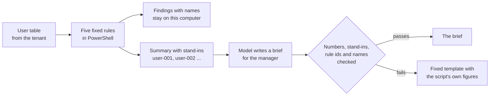

# Microsoft 365 hygiene brief demo

**A Microsoft 365 hygiene check in PowerShell that ends in a one-page brief a manager can act on, written by a model and checked before use: every number it writes in digits must appear in the findings summary, and every stand-in and rule id must be one of the summary's own.**

[](https://github.com/evgenybl/m365-hygiene-brief-demo/actions/workflows/tests.yml)


[](LICENSE)

## The task

An organisation runs on Microsoft 365. Nobody looks regularly at who still holds a licence, which administrators have no second factor, or which guests were forgotten. The administrator can read a findings table. The manager who has to decide cannot, and should not have to.

## How it works



1. **`Get-TenantHygieneFindings.ps1`** reads a flattened user table of the kind an administrator assembles from Microsoft Graph, where the sign-in activity, the licence assignments, the administrator roles and the MFA registration details come from four different sources. It applies five fixed, auditable rules:

   | Rule | What it finds | Why it matters |
   |---|---|---|
   | R1 | Enabled and licensed, no sign-in for more than 90 days | licence cost |
   | R2 | Disabled but still licensed | licence cost |
   | R3 | Administrator without MFA registered, enabled or not | security |
   | R4 | Enabled guest with no sign-in for more than 90 days, or who never signed in and was created more than 30 days ago | security |
   | R5 | Enabled, licensed member who never signed in, created more than 30 days ago | licence cost |

   A date is `yyyy-MM-dd`, or an ISO 8601 timestamp with `Z` or an offset, which counts as its UTC date. `AccountEnabled`, `IsAdmin` and `MfaRegistered` are `true` or `false`, in any letter case. Any other value stops the run with its row number, and nothing is written.

   It writes a file for the administrator, with names, that stays on the computer. It also writes a pseudonymised summary for the AI step, in which every person is a stand-in (`user-001` and so on).
2. **`New-ManagerBrief.ps1`** sends only the stand-in summary to a model and gets back a short brief in plain English for a non-technical manager: what was found, why it matters, and three yes-or-no decisions. **Every number the brief writes in digits must appear in the summary, and every stand-in and rule id must be one of the summary's own.** An ordered-list marker (a line that starts with a single digit 1 to 9, then "." or ")", then a space) and the product name "Microsoft 365" are not counted as numbers, and a date counts as its parts. Digit groups separated by a space, and digits other than 0 to 9, are refused. No name, sign-in address or local part from the user table may appear in it, nor any part of a name or local part with three letters or more, in any letter case; neither may an at sign (@). A brief that fails is not used: a fixed template is filled with the script's own figures instead, and the report says what failed.

Neither script connects to a tenant or changes anything in one. With `-Backend Anthropic`, step 2 sends one request to the Anthropic API, the fixed prompt and the stand-in summary, with the key in its header; nothing else leaves the computer. Neither script e-mails or posts the brief anywhere. A test checks that neither script contains a tenant connect or change cmdlet, a mail command, or a web call other than that one API call.

## Run it

PowerShell 7.1 or later. Nothing to install.

```
pwsh -NoProfile -File Test-Demo.ps1 -OutDir out-test
pwsh -NoProfile -File Get-TenantHygieneFindings.ps1 -UsersCsv users.synthetic.csv -SkusCsv skus.synthetic.csv -AsOf 2026-11-21 -OutDir out-findings
pwsh -NoProfile -File New-ManagerBrief.ps1 -SummaryJson out-findings/findings-summary.json -UsersCsv users.synthetic.csv -OutDir out-brief
```

Each output folder must not exist yet: the scripts refuse to overwrite one.

The live path is `-Backend Anthropic`, with the key in the `ANTHROPIC_API_KEY` environment variable. It is never printed or written. A failed call, or an answer that did not end normally, stops the run with exit code 3, and nothing is written.

## Files

| File | What it is |
|---|---|
| `Get-TenantHygieneFindings.ps1` | Step 1: the five rules, the administrator's file, the stand-in summary |
| `New-ManagerBrief.ps1` | Step 2: the model request, the checks on the answer, the fallback |
| `Test-Demo.ps1` | The tests |
| `prompt-brief.txt` | The fixed prompt |
| `fallback-brief.tmpl` | The template used when a model answer fails a check |
| `recorded-brief.md` | A real answer from a small Claude model (Claude Haiku) to the request built from the shipped data, saved unedited. It passes the checks |
| `recorded-brief-rejected.md` | An earlier answer from the same model to the same request, saved unedited. **The checks reject it for a reference to its own list numbers:** it calls the total "the sum of findings 3 to 5", and the number 5 is not in the summary. Its arithmetic is right, so in substance this is a false alarm. The check is deliberately strict and prefers the fixed template to a text it cannot confirm. It is kept as a test |
| `recorded-brief.meta.json` | Where the two recorded answers came from: the model, the date, the route (a Claude Code subagent given the request text as its whole prompt) and the sha256 of the request they answer. A test checks that the script still builds that exact request |
| `users.synthetic.csv` | Thirteen invented accounts at demo.example.com, each name marked "(synthetic)", with two guests, one account at exactly 90 days since its last sign-in, and one account 6 days old that has never signed in |
| `skus.synthetic.csv` | Three licence names with costs, **both invented**: the names are not real SKU part numbers, and the costs are not Microsoft's prices |

## What the tests cover

63 checks passed, 0 failed (`Test-Demo.ps1`, run on PowerShell 7.7). They also run on every push to main and on pull requests; the badge above shows the last result. The edge cases are built as small tables in the test's own output folder; the shipped files are not changed.

- each rule's count on the shipped data (R1 2, R2 1, R3 2, R4 2, R5 1), the reclaimable total of 390 synthetic units, and that the three cost rules add up to it;
- the boundaries: 90 days since sign-in is not stale and 91 days is; a member created 30 days ago who never signed in is not flagged and one created 31 days ago is; the same for a guest, and a guest invited yesterday is not flagged;
- a `Z` timestamp near midnight counts by its UTC date, the same on any machine, and so does a timestamp with an offset; `true` and `false` are read in any letter case; a day-first date, a blank `AccountEnabled` and a mistyped `IsAdmin` each stop the run with the row number, and nothing is written;
- a clean one-user tenant (every count 0) and the shipped data without its R2 row both run; under a culture with a decimal comma, the files still carry `12.5`;
- no name or address reaches the summary, and an existing folder is never overwritten;
- the recorded model brief passes the checks and is used unchanged, and the request the script builds today has the sha256 the recorded answers were recorded against;
- each kind of wrong text is caught and the filled template is used instead, with no placeholder left: an invented figure, a number at the start of a line, "390 000" and "2 000" (digit groups separated by a space), invented stand-ins and rule ids, a digit other than 0 to 9, a person's name written five ways, an at sign, and an empty answer;
- the real answer that cites its own list numbers is refused for the 5, and the template is used: a false alarm in substance, kept to show that the check prefers the template to a text it cannot confirm;
- a personal value put into the summary stops the run before anything is sent; a tenant with an `admin@` account and a display name "Finance" can still run step 2;
- the API path against a local mock of the Messages API: path, version header, key header, 4096 tokens, no personal data in the body, and the text accepted; an HTTP error, an answer cut off at the token limit, an answer with no text and a connection error each stop the run with exit code 3, and nothing is written; a missing key gives a clear refusal; the placeholder key appears in no output;
- neither script contains a tenant connect or change cmdlet, a mail command, or a web call other than the one API call.

## Limits, stated plainly

- **Synthetic data, and not run against a real tenant.** A real job adds the organisation's own data, the permissions to read it, and an agreement on how the data is handled. Sign-in data in a real tenant has gaps of its own, such as accounts that never appear in the sign-in log. The rules would be tuned to the tenant.
- **The summary is pseudonymised, not anonymous.** It still carries each flagged person's department, licences and days since sign-in, and in a small tenant that can point to one person.
- **The checks on the model's text have gaps.** They do not catch a number written in words, a right number attached to the wrong finding, or a percentage or scale word around a valid number ("100%", "390 thousand"). Only names taken from the user table are checked, so a name the table does not hold cannot be caught. A part of a name that the request itself uses as a word, and the number words one to ten, are not looked for; nor, before sending, is a display name that is also a department name.
- **The script's own API path was tested against a local mock only**, not against the real service. The two recorded answers were obtained by another route, named in `recorded-brief.meta.json`.
- **One recorded brief is not a measure of quality.** The checks catch the kinds of wrong text listed above, not every kind. Whether the wording is right for a given manager is a person's call.
- **The costs are invented units.** No saving in money is shown or promised.
- This is a demonstration of a design, not a product and not a record of client work.

## The design in one line

The script finds, the AI explains, a strict check refuses what it cannot confirm, a person decides.

## Licence

MIT. See [LICENSE](LICENSE).

This is an independent demo, not affiliated with or endorsed by Microsoft or Anthropic. Microsoft 365 and Entra are Microsoft's trademarks.

## Author

Evgeny Blekhman · [LinkedIn](https://www.linkedin.com/in/evgeny-blekhman/)
