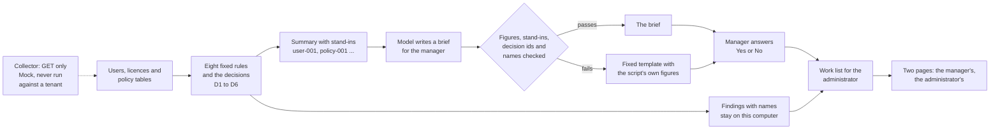

# Microsoft 365 hygiene brief demo

**A manager gets a one-page brief in plain words about the organisation's Microsoft 365 accounts, and answers a few
yes-or-no questions. The administrator keeps the names and the details on their own computer, and gets a work list made
only from the questions the manager answered Yes.**

[](https://github.com/evgenybl/m365-hygiene-brief-demo/actions/workflows/tests.yml)


[](LICENSE)

Everything here runs on an invented organisation. Nothing was ever run against a real Microsoft 365 tenant (the
organisation's own space in Microsoft 365: its accounts, its licences, which are the paid seats, and its sign-in rules).

## What you see

The manager's page (`manager.html`) shows the brief, the findings by rule, and each decision with its answer. Its first
lines, from `examples/brief/brief.md`:

<!-- pasted: file examples/brief/brief.md -->
```text
The check covered 60 user accounts and 6 sign-in policies, as of 2026-11-21.

**Security findings**

- Administrator accounts without a second sign-in step: 3. Without that second step, a stolen password is enough to take over an account that can change the whole system.
```

This brief is a real model answer, labelled **Recorded** here and on the pages, with the caveats in *What is real here*,
below. The whole story ends in this table, drawn from a real run:


## Try it in two minutes

PowerShell 7.4 or later; nothing to install. The tests were run here with PowerShell 7.7.0 and 7.4.6 on Windows. The workflow
in .github/workflows/tests.yml is set to run them on Linux and on Windows; its first step prints the PowerShell version of
each runner, and the badge above shows the result of its last run. Each command writes into a new folder and refuses to
write over one that exists.

The whole story, on the invented tenant in `data/`:

<!-- pasted: run -->
```text
$ pwsh -NoProfile -File Invoke-Demo.ps1
Microsoft 365 hygiene demo: synthetic data, as of 2026-11-21
findings    OK       users 60 | policies 6 | R1 7 | R2 2 | R3 3 | R4 2 | R5 1 | R6 1 | R7 1 | R8 2 | reclaimable (invented units) 169.4 | people flagged 14 | decisions D1 D2 D3 D4 D5 D6
brief       OK       backend Recorded | text accepted True | problems 0 | summary sent to the API False | Recorded: claude-haiku-5-5, on 2026-11-24
decisions   OK       5 answers recorded: D1 Yes, D2 Yes, D3 Yes, D4 No, D5 Yes; D6 left open
work list   OK       work list items 11 | from D1 D2 D3 D5 | answered No D4 | open D6
pages       OK       pages manager.html (stand-ins only, may leave this computer) and admin.html (names; stays on this computer) | brief: Recorded: claude-haiku-5-5, on 2026-11-24
```

One case of the failure gallery (all nine are below):

<!-- pasted: run -->
```text
$ pwsh -NoProfile -File Invoke-Demo.ps1 -Case bad-date
case bad-date: the second row of the users table has a day-first date, 21/08/2026
findings    OK       REFUSED (exit 2): row 2: LastSignInDate is not yyyy-MM-dd or an ISO 8601 timestamp with Z or an offset
result      OK       nothing written: yes
case bad-date: as expected
```

The two report pages, again from the demo's folders; open `out-pages/manager.html` in a browser:

<!-- pasted: run -->
```text
$ pwsh -NoProfile -File New-HygieneReport.ps1 -FindingsDir out-demo/findings -BriefDir out-demo/brief -WorklistDir out-demo/worklist -UsersCsv data/users.synthetic.csv -DataKind Synthetic -OutDir out-pages
pages manager.html (stand-ins only, may leave this computer) and admin.html (names; stays on this computer) | brief: Recorded: claude-haiku-5-5, on 2026-11-24
```

The tests (what they cover, and the last lines of a run, are in [docs/TESTS.md](docs/TESTS.md)):

```text
pwsh -NoProfile -File Test-Demo.ps1
```

## How it works



1. **`Get-TenantHygieneFindings.ps1`** reads three tables: users, licences, and Conditional Access policies (the sign-in
   rules of the tenant: who may sign in, from where, and with what proof). It applies eight fixed rules and writes the
   administrator's file with names, and a summary for the model and the manager in which every person and policy is a
   stand-in. The summary also carries the decisions, fixed by the script: each has an id, a plain question and the rules
   it covers, and it is asked only when one of those rules found something.
2. **`New-ManagerBrief.ps1`** sends only that summary to a model and checks the brief it gets back: every figure must be
   in the summary, every stand-in and rule id must be the summary's own, every decision id exactly once, and no name or
   address from the users table may appear. A brief that fails is not used; a fixed template is filled with the script's
   own figures instead, and the report says why.

### What the checks did not catch in the two real answers

Both recorded answers in `recordings/` pass every check above. Read by a person, they show three things no check looks for.

<!-- quotes: recordings/brief.recorded.md -->
The first answer does not say that the finding about Global Administrators names no person, which the request asks for:
"Global Administrator accounts: 5, where the limit is 4. Each extra top-level administrator is another way in and another person who can change everything."
It does say so for the two policy findings: "This is a tenant-wide setting and names no person." and "These are policy settings and name no person."
No check looks for that sentence.

<!-- quotes: recordings/brief.recorded-2.md -->
The second answer writes most of its counts in words, as in "Three administrator accounts have no second sign-in step (MFA) set up.",
and so with "Five accounts", "Two guest accounts" and "Seven enabled accounts". The figure check reads digits only, so
those counts were not checked by code.

<!-- quotes: recordings/brief.recorded.md -->
Both answers add a reason to each finding in their own words. In the first: "a stolen password is enough to take over an account that can change the whole system".

<!-- quotes: recordings/brief.recorded-2.md -->
In the second: "they give a false sense of protection". These reasons are reasonable, and nobody verified them.

A manager's brief is read by a person before it reaches the manager, because the checks prove only what they test
(figures written in digits, ids, stand-ins and names), not that each sentence is right or complete.

3. **`Set-BriefDecision.ps1`** records the manager's answer to one decision (Yes, or No with a reason), with the name the
   person types and the time, bound to that exact summary.
4. **`New-AdminWorklist.ps1`** writes the administrator's work list: the accounts and items of the decisions answered
   Yes, and nothing else. It changes nothing in the tenant.
5. **`New-HygieneReport.ps1`** writes the two pages: the manager's, with stand-ins only, which may leave the computer; and
   the administrator's, with the names and the work list, which says at its top that it stays.

`Export-TenantSnapshot.ps1` would fill the three tables from Microsoft Graph, with GET requests only, and is labelled:
**Mock: written from Microsoft's documentation, tested against a local mock, never run against a tenant.** Each request,
the documentation page it was written from, the permission and the licence it needs are in
[docs/COLLECTOR.md](docs/COLLECTOR.md).

| Rule | What it finds | Why it matters |
|---|---|---|
| R1 | An enabled account with a licence (a paid seat) and no sign-in for more than 90 days | licence cost |
| R2 | A disabled account that still holds a licence | licence cost |
| R3 | An administrator without MFA registered (multi-factor authentication: a second sign-in step, such as a prompt on a phone), enabled or not | security |
| R4 | An enabled guest with no sign-in for more than 90 days, or who never signed in and was invited more than 30 days ago | security |
| R5 | An enabled, licensed member who never signed in, created more than 30 days ago | licence cost |
| R6 | More than 4 accounts hold the Global Administrator role, enabled or not (one finding about the tenant) | security |
| R7 | No enabled Conditional Access policy blocks legacy authentication (older sign-in methods that cannot ask for a second step) for all users and all resources (one finding about the tenant) | security |
| R8 | A Conditional Access policy left in report-only mode (it records what it would do and enforces nothing) for more than 30 days after it was created, or with no creation date (reported as unknown, never given an age) | security |

A user who never signed in is judged by R5 or R4, never by R1, so no one is counted twice for the same cost. A date is
`yyyy-MM-dd`, or an ISO 8601 timestamp with `Z` or an offset, which counts as its UTC date; any other value stops the run
with its row number, and nothing is written. The limits (90, 30, 4, 30) are parameters. The costs are exact decimals in
units invented for the demo. The reasons behind each choice are in [docs/DESIGN.md](docs/DESIGN.md).

## What is real here

| Path | Label | What was actually run |
|---|---|---|
| The eight rules and their refusals | Local | Run by the tests and the demo, on invented tables |
| The checks on the brief | Local | Run by the tests on dozens of wrong texts, and on every saved answer |
| The decisions, the work list and the two pages | Local | Run by the tests and the demo |
| The brief the demo uses, `recordings/brief.recorded.md` | Recorded | A real answer of one small model (claude-haiku-5-5) to the request the shipped data gives, passed by every check. It was given the request through a Claude Code subagent, which also runs under its harness's own system prompt, so it is not the live path's call. Its sha256 shows that the file has not changed since it was added and which request it answers; that the model wrote it rests on the author's record |
| A second answer, `recordings/brief.recorded-2.md` | Recorded | Obtained the same way, also passed by every check; not used by the demo |
| `recordings/brief.constructed.md` | Constructed | Written by hand, not from a model; used only by `Test-Demo.ps1`, as a known text: for the checks on decision ids, the label tests, the tests of `Add-RecordedBrief.ps1`, the decisions, work list and pages tests, and as the mock model's reply |
| The two earlier answers in `recordings/earlier/` | Recorded | Real answers of a small Claude model to the earlier, five-rule request; a test rebuilds that request and checks its sha256 |
| The live model path (`-Backend Anthropic`) | Mock | Run against a local mock of the Messages API only |
| The collector (`Export-TenantSnapshot.ps1`) | Mock | Mock: written from Microsoft's documentation, tested against a local mock, never run against a tenant |

This has not been run against a tenant.

**What a command you can run shows:** that the rules, the checks, the refusals, the decisions, the work list and the
pages behave as described, on the invented data; that `examples/` is exactly what the demo writes, in any culture; that
the collector sends only GET requests to its fixed paths, as a mock records them; that each recorded answer is the file
added and answers the request it names.

**What rests on the author's word:** that the recorded answers came from the model and by the route their meta files name;
and that neither the collector nor the live model path was ever run against the real services.

## What can go wrong, and what happens

Each case runs alone with `-Case <name>`, or all together:

<!-- pasted: run -->
```text
$ pwsh -NoProfile -File Invoke-Demo.ps1 -Case all
case clean-tenant: one account, signed in yesterday, MFA registered; legacy authentication blocked
findings    OK       users 1 | policies 1 | R1 0 | R2 0 | R3 0 | R4 0 | R5 0 | R6 0 | R7 0 | R8 0 | reclaimable (invented units) 0 | people flagged 0 | decisions none
result      OK       every count is 0, nothing is reclaimable, and no decision is asked
case clean-tenant: as expected
case bad-date: the second row of the users table has a day-first date, 21/08/2026
findings    OK       REFUSED (exit 2): row 2: LastSignInDate is not yyyy-MM-dd or an ISO 8601 timestamp with Z or an offset
result      OK       nothing written: yes
case bad-date: as expected
case invented-figure: the recorded brief, with a sentence added that holds a figure the summary does not hold
brief       OK       text refused: figures not in the summary: 500
result      OK       brief.md is the fixed template with the script's own figures, and brief-report.json says why
case invented-figure: as expected
case missing-decision: the recorded brief, with the line of decision D4 taken out
brief       OK       text refused: a decision left out: D4
result      OK       brief.md is the fixed template with the script's own figures, and brief-report.json says why
case missing-decision: as expected
case decision-no: D5 (remove the stale guests) is answered No; D1 (MFA for administrators) Yes
work list   OK       work list items 3 | from D1 | answered No D5 | open D2 D3 D4 D6
result      OK       rows for R4 (D5, No): 0 | rows for R3 (D1, Yes): 3
case decision-no: as expected
case other-summary: a decisions file written for one summary is put beside another
decision    OK       REFUSED (exit 2): decisions.json was written for another summary; it is left as it is
work list   OK       REFUSED (exit 2): decisions.json was written for another summary
result      OK       the decisions file is byte for byte as it was: yes | no work list written: yes
case other-summary: as expected
case collector-throttled: the local Graph mock answers the licence request with 429 and Retry-After: 1, once
collector   OK       snapshot users 6 | licences 2 | policies 2 | GET requests 7 | throttled waits 1 | Mock: never run against a tenant
result      OK       requests the mock received: 7 GET, 0 other
case collector-throttled: as expected
case collector-403: the local Graph mock answers the users request with 403
collector   OK       REFUSED (exit 3): GET users answered HTTP 403; nothing was written
result      OK       requests the mock received: 1 GET, 0 other
case collector-403: as expected
case model-500: the live model path, against a local mock of the Messages API that answers 500
brief       OK       REFUSED (exit 3): the API call failed; nothing was written
result      OK       requests the mock received: 1; nothing written: yes
case model-500: as expected
cases 9 | as expected 9 | not as expected 0
```

"OK" on a line means the step ended as the case expects, a refusal included. The mocks listen on this computer only.

## Recording a real model answer

This is how the two answers in `recordings/` were added. The request is the fixed prompt and the stand-in summary,
nothing else. This writes it to a file, exactly as it would be sent:

<!-- pasted: run -->
```text
$ pwsh -NoProfile -File New-ManagerBrief.ps1 -SummaryJson examples/findings/findings-summary.json -UsersCsv data/users.synthetic.csv -WriteRequest request.txt
wrote the request | bytes 6023 | sha256 4a66f63a742bf321c950aa8618353c595d3a158e464fc9609cb21e8db5391cee
```

Give that text, as the whole prompt, to a model; save its answer unedited; then add it with `Add-RecordedBrief.ps1`,
which copies the answer byte for byte, writes its meta file (origin "recorded", the model's name, how it was obtained),
and refuses if the request file is not the request the script builds today:

```text
pwsh -NoProfile -File Add-RecordedBrief.ps1 -Answer answer.md -RequestFile request.txt -SummaryJson examples/findings/findings-summary.json -Model <model name> -Obtained "<how it was obtained>" -RecordedOn <yyyy-MM-dd> -Name brief.recorded-3
```

Then pass `-Recorded recordings/brief.recorded-3.md` to `New-ManagerBrief.ps1`; without it, the brief is the first recording,
`recordings/brief.recorded.md`. The live path is `-Backend Anthropic`, with
the key in the `ANTHROPIC_API_KEY` environment variable; it is never printed or written.

## Limits, stated plainly

- **Invented data, and not run against a tenant.** A real job adds the organisation's own data, the permissions to read
  it, and an agreement on how the data is handled. Sign-in data in a real tenant has gaps of its own. The rules would be
  tuned to the tenant.
- **R6 to R8 depend on tables a real tenant fills differently.** Role holders that are groups, eligible role
  assignments, policies scoped to groups or with exclusions, and policies switched into report-only mode after they were
  created all need a person's reading; R8 counts days from a policy's creation, and reports a policy with no creation
  date as of unknown age.
- **The collector's first real run would have to confirm its permissions, its paging and its answers on a live tenant**
  (the list is at the end of [docs/COLLECTOR.md](docs/COLLECTOR.md)). It reads the documentation's account of each
  request, not a tenant.
- **A decision records the name a person types.** It is not checked against any directory and proves nothing about who
  typed it. The manager's page shows that name as typed, so a manager who is also in the users table appears there by name,
  as the one who decided.
- **The summary is pseudonymised, not anonymous.** It still carries each flagged person's department, licences and days
  since sign-in, and in a small tenant that can point to one person.
- **The checks on the brief have gaps.** They do not catch a number written in words (the second recorded answer writes
  most of its counts so; see *What the checks did not catch in the two real answers*), a sentence the request asked for and
  the answer left out, a right number attached to the
  wrong finding, or a percentage or scale word around a valid number ("100%", "169.4 thousand"). Only names the users
  table holds are looked for; a part of a name that the request itself uses as a word, and the number words one to ten,
  are not; nor, before sending, is a display name that is also a department name.
- **The label "Recorded" proves that the answer and the request are the ones in the meta file,** not who or what wrote
  the answer.
- **The live model path was tested against a local mock only**, not against the real service.
- **Two recorded briefs are not a measure of quality.** Whether the wording is right for a given manager is a person's call.
- **The costs are invented units.** No saving in money is shown or promised.
- This is a demonstration of a design, not a product and not a record of client work.

## How this was built

The rules follow the author's own earlier administration scripts and checklist, rewritten for this repository. The
design is in [docs/DESIGN.md](docs/DESIGN.md), the tests in [docs/TESTS.md](docs/TESTS.md), the collector's sources in
[docs/COLLECTOR.md](docs/COLLECTOR.md). `examples/` is the real output of the whole story; `Update-Examples.ps1` writes it
again, and the CI workflow is set to fail on any difference. The invented tenant in `data/` is what `New-SyntheticTenant.ps1` writes for the
seed named in `data/tenant-source.txt`.

## Usage conditions

- MIT licence: see [LICENSE](LICENSE). The software is provided as is, without warranty of any kind.
- All the data is invented: the people at demo.example.com, marked "(synthetic)", the licence names and the costs.
- This is an independent demo, not affiliated with or endorsed by Microsoft or Anthropic. Microsoft 365 and Entra are
  Microsoft's trademarks; Claude is Anthropic's.
- It has never been run against a tenant. Pointing the collector at one is the reader's own decision and responsibility.

## Author

Built by Evgeny Blekhman. Written with Claude Code under the author's direction.
[linkedin.com/in/evgeny-blekhman](https://www.linkedin.com/in/evgeny-blekhman/)
